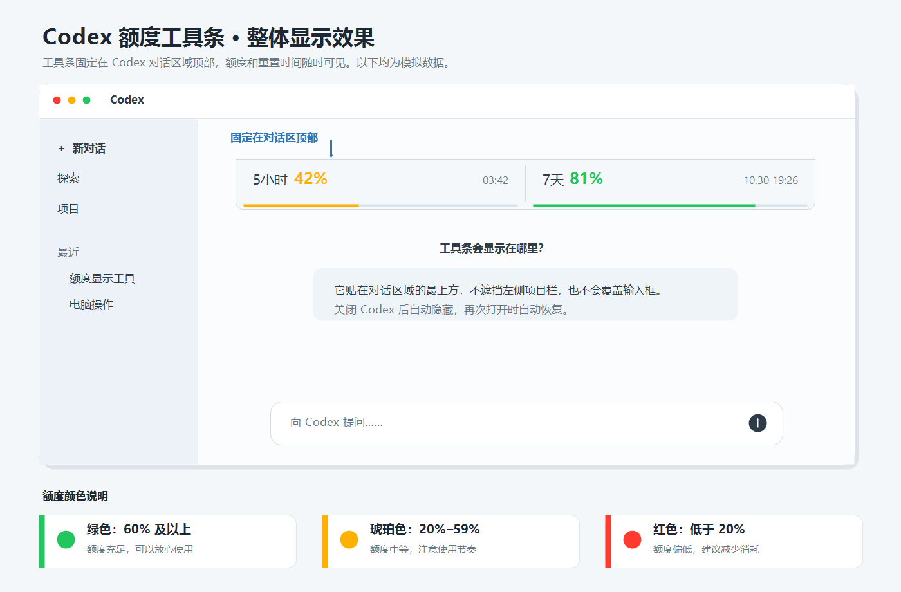

# Codex 额度工具条

[](https://github.com/zhangmingxi050208-creator/codex-quota-toolbar/actions/workflows/build.yml)

一个轻量的 Windows 桌面工具条，在 Codex 窗口顶部显示当前 5 小时和 7 天额度、重置时间以及彩色进度条。

> 本项目是社区开源工具，并非 OpenAI 官方产品。

<p align="center">
  
</p>

## 功能

- 自动读取当前登录用户自己的 Codex 额度
- 跟随 Codex 窗口显示，Codex 不在前台时自动隐藏
- Codex 关闭后停止刷新，再次打开时自动恢复
- 每分钟自动刷新，也可以左键单击立即刷新
- 额度充足时显示充电绿，中等额度显示亮琥珀色，低于 20% 显示亮红色
- 按当前用户安装，无需管理员权限
- 支持开机启动和 Windows 标准卸载

## 安装

[直接下载 Windows 安装包](https://github.com/zhangmingxi050208-creator/codex-quota-toolbar/raw/refs/heads/main/dist/Codex%E9%A2%9D%E5%BA%A6%E5%B7%A5%E5%85%B7%E6%9D%A1-Setup.exe)，双击运行即可。

由于社区版本没有商业代码签名证书，Windows SmartScreen 可能在首次运行时显示提醒。你也可以审查源码后自行编译。

## 使用要求

- Windows 10 或 Windows 11
- 已安装并登录 Codex 桌面端
- 系统自带 .NET Framework 4.x

## 数据与隐私

程序只在本机启动 Codex runtime，并调用只读的 `account/rateLimits/read` 接口。它不会读取对话内容，不会上传登录凭据，也不包含遥测或第三方网络请求。

## 从源码构建

在 Windows PowerShell 中运行：

```powershell
.\build.ps1
```

脚本使用 Windows 自带的 .NET Framework C# 编译器，生成：

- `CodexQuotaToolbar.exe`：免安装主程序
- `dist\Codex额度工具条-Setup.exe`：一键安装包

## 项目结构

- `CodexQuotaToolbar.cs`：工具条主程序
- `CodexQuotaToolbarSetup.cs`：安装与卸载程序
- `build.ps1`：构建脚本
- `.github/workflows/build.yml`：GitHub Actions 自动构建

## 参与开发

欢迎提交 Issue 和 Pull Request。开始前请阅读 [CONTRIBUTING.md](CONTRIBUTING.md)。

## 许可证

[MIT License](LICENSE)

